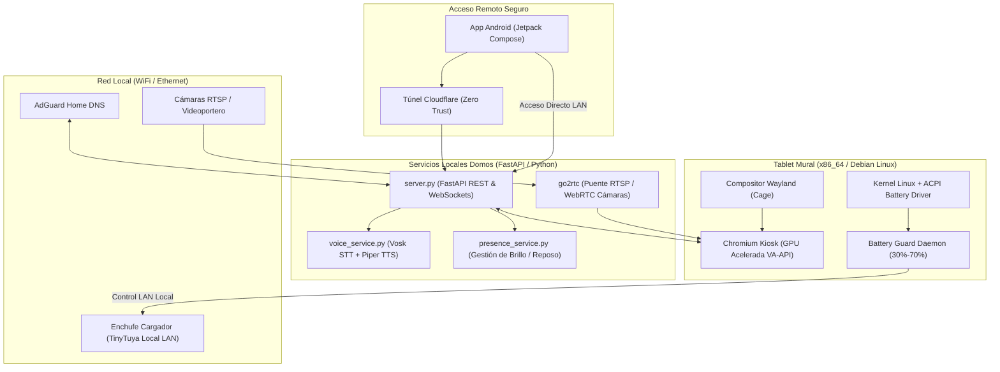

# 🏛️ Domos: Open-Source Smart Home Wall Kiosk & OS

[](https://opensource.org/licenses/MIT)
[](https://www.python.org/)
[](https://github.com/cage-kiosk/cage)
[](https://developer.android.com/kotlin)
[](https://github.com/angelcabre-code/domos/releases/tag/v1.0.0)
[-yellow.svg)](https://kernel.org)

**Domos** es un sistema operativo y centro de control domótico integral diseñado para devolver a la vida tablets y dispositivos convertibles obsoletos (como las **Asus Transformer Book T100TA / T200TA**, Lenovo Miix o Acer Switch con procesadores Intel Atom Bay Trail / Cherry Trail), convirtiéndolos en elegantes **pantallas murales domóticas 24/7** con estética *glassmorphism*, asistente de voz 100% offline, protección química de batería y control unificado multi-ecosistema.

---

## 🌟 Características Principales

### 1. 🖼️ Marco Fotográfico y Salvapantallas Cinematográfico
* **Transiciones de alta gama (4,2 segundos):**
  * **🫧 Desenfoque Glassmorphism:** La foto saliente se difumina suavemente hacia un bokeh cristalino `blur(28px)` y, desde esa profundidad etérea, la nueva fotografía florece progresivamente hasta nitidez absoluta.
  * **✨ Dinámico por Luminancia:** Análisis fotométrico de cada imagen en tiempo real; las fotografías brillantes funden a blanco puro y las oscuras/nocturnas a negro profundo.
  * **🌙 Fundido a Negro** y **☀️ Fundido a Blanco** cinematográficos.
* **Aceleración por Hardware en GPU Intel Gen7:** Renderizado a 60 FPS sin tirones mediante arquitectura ping-pong de doble búfer y liberación de texturas VRAM.
* **Protección Antiquemado (Anti-Burn-In):** Desplazamiento periódico imperceptible de píxeles para proteger paneles LCD IPS encendidos continuamente.

### 2. 🔋 Batería Inteligente y Prevención de Hinchamiento (100% Offline LAN)
* **Régimen de ciclado 30% $\leftrightarrow$ 70%:** Controla automáticamente un enchufe inteligente para cortar la carga al 70% y reanudarla al 30%. Mantener la celda de litio por debajo de 3,92 V evita la descomposición del electrolito, la generación de gases y el hinchamiento físico (*spicy pillow*).
* **Control Local Directo (TinyTuya LAN):** Comunica directamente con el enchufe inteligente a través de la red WiFi local (UDP/TCP). Si se cae la conexión a Internet o fibra óptica, el ciclado de batería continúa funcionando con **cero dependencia de la nube**.
* **Monitor de Salud y Degradación:** Lectura directa del bus ACPI del chip fuel-gauge (`charge_full` vs `charge_full_design`), recuento de ciclos de celda, vatios en tiempo real y gráfica histórica de duración de cargas y descargas (diurna con pantalla encendida vs nocturna en reposo).

### 3. 🏠 Hub Domótico Multi-Ecosystem
* **Tuya / SmartLife:** Integración híbrida en nube y local de luces, enchufes, interruptores y sensores.
* **eWeLink / Sonoff:** Control directo de relés y conmutadores.
* **Xiaomi Mi Home (python-miio):** Telemetría y control de robots aspiradores y purificadores de aire.
* **CCTV en Directo (go2rtc):** Visualización WebRTC / HLS de videoporteros y cámaras de seguridad con latencia inferior a 300 ms y audio bidireccional.
* **Monitor AdGuard Home:** Telemetría de consultas DNS bloqueadas y botón rápido para pausar o reanudar el filtrado de red.
* **Placas Solares y Red Eléctrica:** Gráfica de generación fotovoltaica y consumo de red en tiempo real.

### 4. 🎙️ Asistente Vocal 100% Offline y Privado
* Reconocimiento de voz local mediante **Vosk** (modelo en español) y síntesis de voz neuronal de alta naturalidad mediante **Piper TTS**.
* Sin enviar ni un solo byte de audio a servidores externos.
* Regulación inteligente del volumen con freno acústico de seguridad al 70% para proteger altavoces integrados y soporte para barras de sonido externas.

### 5. ⚠️ Motor de Incidencias en Tiempo Real
* Supervisa continuamente baterías bajas en sensores inalámbricos ($\le 20\%$).
* Detecta caídas de tensión ($< 180\text{ V}$) o sobretensiones ($> 255\text{ V}$) en la red eléctrica del hogar.
* Alerta parpadeante discreta en la pantalla de espera y notificación inmediata en la app móvil.

### 6. 📱 Aplicación Móvil Android Nativa (`domos-remote`)
* Escrita en **Kotlin** con **Jetpack Compose**.
* Espejo de pantalla interactivo con inyección táctil remota.
* Envío de mensajes de voz y texto al terminal mural.
* Conmutación automática transparente entre red local (LAN) y túnel remoto seguro (Cloudflare Zero Trust) sin abrir puertos en el router.

---

## 📐 Arquitectura del Sistema



---

## 🚀 Instalación y Puesta en Marcha

### 1. Requisitos de Hardware
* Tablet convertible x86 (ej. Asus Transformer T100TA, T100CHI, T200TA o similares con 2 GB / 4 GB RAM y almacenamiento eMMC / SSD).
* Sistema operativo recomendado: **Debian 12 (Bookworm)** o **Debian 13 (Trixie)** minimal sin entorno de escritorio pesado.
* En tablets con UEFI de 32 bits y procesador de 64 bits (típico de Bay Trail), utiliza una imagen de Debian multi-arch (`bootia32.efi`).

### 2. Paquetes del Sistema
```bash
sudo apt update && sudo apt install -y \
  cage chromium brightnessctl alsa-utils pulseaudio \
  python3 python3-pip python3-venv git curl jq \
  vainfo intel-media-va-driver-non-free
```

### 3. Clonar y Configurar Entorno
```bash
sudo git clone https://github.com/angelcabre-code/domos.git /opt/domoskiosk
sudo chown -R $USER:$USER /opt/domoskiosk
cd /opt/domoskiosk

# Instalar dependencias Python
pip3 install fastapi uvicorn requests tinytuya websockets python-miio --break-system-packages
```

### 4. Configurar Credenciales y Dispositivos
Copia las plantillas de configuración de `/opt/domoskiosk/kiosk/config.example/` a `/opt/domoskiosk/`:
```bash
cp kiosk/config.example/kiosk_config.example.json kiosk_config.json
cp kiosk/config.example/battery_config.example.json battery_config.json
cp kiosk/config.example/devices.example.json devices.json
cp kiosk/config.example/presence_config.example.json presence_config.json
cp kiosk/config.example/tuya_config.example.json tuya_config.json
```
Edita los archivos con las IPs locales de tu red, IDs de dispositivo y claves de API deseadas.

### 5. Activar Servicios Systemd
```bash
sudo cp kiosk/systemd/*.service /etc/systemd/system/
sudo systemctl daemon-reload
sudo systemctl enable --now domoskiosk-server.service domoskiosk-battery.service domoskiosk-cage.service
```

---

## 📱 Compilación de la Aplicación Android

La aplicación remota se encuentra en la carpeta `android/`:
1. Abre la carpeta `android` en **Android Studio**.
2. Modifica la URL de tu túnel o servidor local en `DomosApiClient.kt` o configúrala desde la interfaz de la app.
3. Compila el APK de lanzamiento:
   ```bash
   cd android
   ./gradlew assembleRelease
   ```

---

## 🛡️ Seguridad y Privacidad

* **Cero Telemetría a Terceros:** Todo el procesamiento vocal, estado domótico y analítica de energía se realiza de forma local dentro del terminal.
* **Seguridad de Batería Garantizada:** El software no requiere abrir ni retirar físicamente la batería de la tablet; la protege activamente contra deformaciones mediante ciclado químico inteligente en baja tensión.
* **Sin Puertos Abiertos:** El acceso remoto se realiza mediante túneles autenticados por token y cookies criptográficas seguras.

---

## 📄 Licencia

Este proyecto se distribuye bajo la licencia **MIT**. Consulta el archivo [LICENSE](LICENSE) para más detalles.
